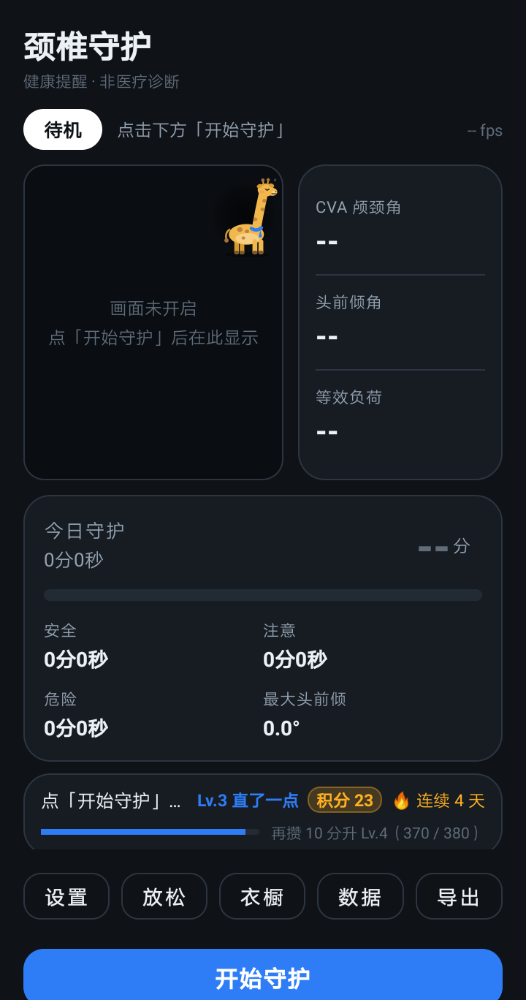
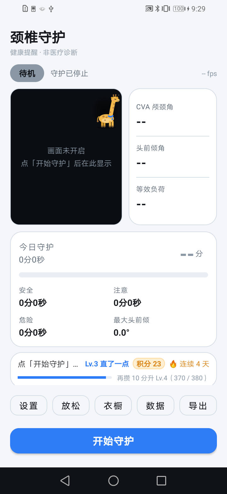
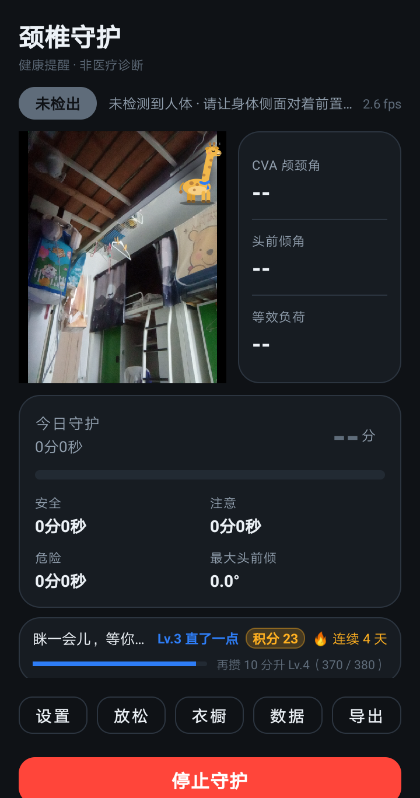
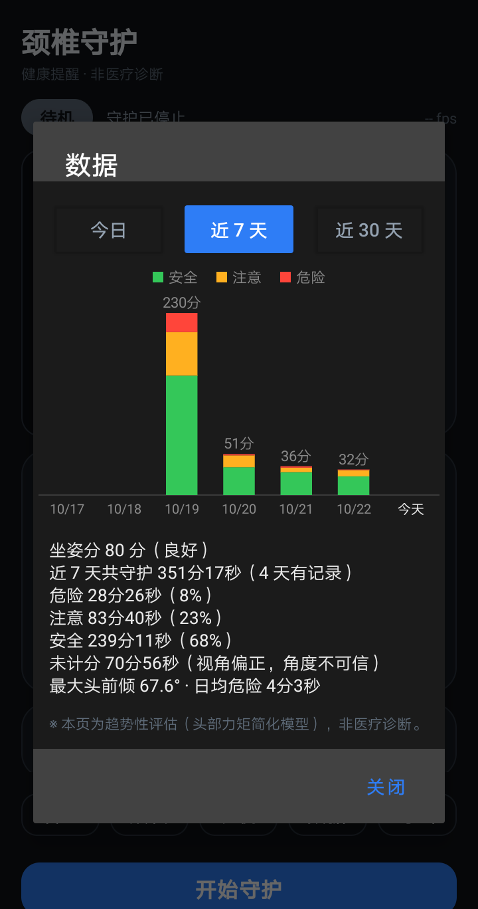
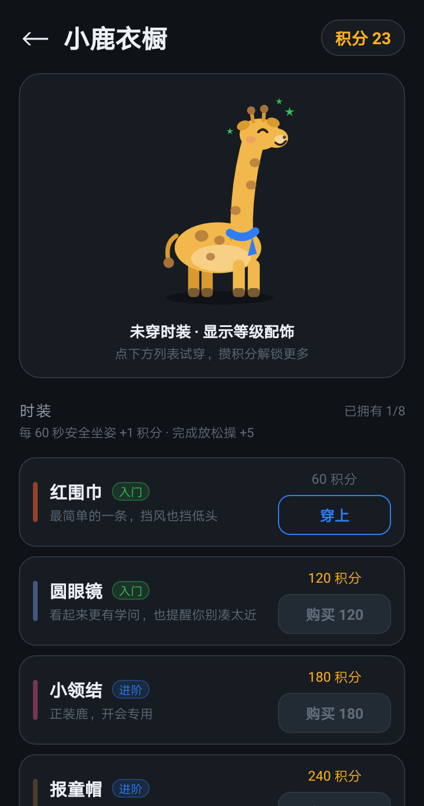
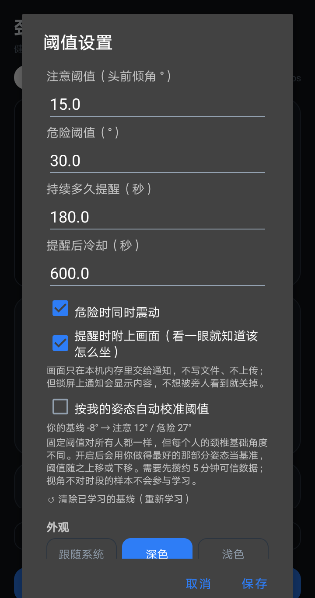

# 颈椎守护 · Cervical Guard

> 用前置摄像头实时监测坐姿，低头太久会提醒你。**所有计算都在手机本地完成，不联网、不上传。**

[](LICENSE)
[]()
[]()

---

## 这是什么

长时间低头看屏幕，颈椎承受的负荷会成倍增加。这个 App 用手机前置摄像头**实时**估算你的头前倾程度，超过阈值就提醒你抬头；顺带记录每天的坐姿分布，让你看到自己的变化。

**它不是一个"健康诊断"工具**，只是一个帮你察觉姿势的提醒器。

## 功能

| 功能 | 说明 |
|---|---|
| **实时坐姿检测** | 前置摄像头 + MediaPipe 姿态模型，本机推理（约 3 fps） |
| **三项指标** | CVA 颈颅角、头前倾角、等效负荷（Hansraj 2014 模型） |
| **三级判定** | 安全 <15° / 注意 15~30° / 危险 ≥30° |
| **角度可信度自检** | 视角偏正时角度不可信，会自动标注并不计入统计 |
| **超时提醒** | 连续低头 / 15 分钟内累计低头 / 长时间工作疲劳，三种触发；通知 + 震动 + 语音 + 可选画面截图 |
| **放松操** | 收下巴动作引导，含示范动画与评分 |
| **统计** | 今日 / 近 7 天 / 近 30 天，分级堆叠柱状图 |
| **数据导出** | 一键导出 CSV（由你主动触发，走系统分享） |
| **成长系统** | 小鹿等级、积分、8 件时装与衣橱 |
| **深色 / 浅色** | 跟随系统或手动切换 |

## 截图

| 主界面（深色） | 主界面（浅色） | 实时检测 |
|---|---|---|
|  |  |  |

| 数据统计 | 小鹿衣橱 | 阈值设置 |
|---|---|---|
|  |  |  |

> 实时检测那张是"未检出"状态（没有真人入镜）。真机检测效果请自己装一个试。

## 网页版（浏览器直接用）

不想装 App 可以先试网页版：**<https://USERNAME.github.io/cervical-guard/web/>**
（部署见 docs/web/README.md；需 https 才能用摄像头）


1. 到 [Releases](https://github.com/USERNAME/cervical-guard/releases) 页面下载最新的 `颈椎守护-x.y.z-release.apk`
2. 手机上点开安装（需要允许「安装未知来源应用」）
3. 首次打开授予**相机权限**，然后点「开始守护」

**系统要求**：Android 7.0 (API 24) 及以上，需要前置摄像头。

> ⚠️ 直接装 APK 会触发系统的"未知来源"提示 / Play 保护扫描提示，这是所有非商店渠道分发的正常现象。本 App 不申请网络权限，你可以自己用 `aapt dump permissions` 或任何权限查看器核对。

## 怎么用才准

这个 App 的核心是**从侧面看你的脖子**，所以：

- 📱 手机**侧放**，镜头能拍到你的**侧脸 + 肩膀**（放桌子侧面、或斜 45° 用支架）
- 🚫 正面对着镜头时**测不出头前倾**——此时 App 会显示「角度不可信」，这些时间不计分
- 💡 光线别太暗，背景别太乱
- 🎧 戴头戴耳机时耳点会被遮住，App 有抖动检测会自动改用鼻-肩测量

## 隐私

**本 App 不申请网络权限**（`INTERNET` 与 `ACCESS_NETWORK_STATE` 已从清单中显式移除），因此：

- 相机画面只在内存中处理，**不写入文件、不上传**
- 坐姿数据存在本机 SQLite，卸载即删除
- CSV 导出由你主动点击，通过系统分享面板发给你自己选的应用
- 无广告、无统计 SDK、无账号系统

完整说明见 [PRIVACY.md](PRIVACY.md)。

> 说明：底层 MediaPipe 依赖里含 Google 的遥测组件（datatransport），它会在无网络权限的情况下尝试上报并失败——**不产生任何网络流量**。这段在 `app/build.gradle.kts` 里有详细注释。

## 已知限制

- 需要侧身对镜头，正面测不准
- 视角 >50° 时角度不可信（App 会标注，不计分）
- 帧率约 3 fps（老设备上更低），不是医疗级测量
- 只在华为 Android 9 / 32 位上做过长时间实测，其他机型未全面验证

## 从源码构建

**Windows（PowerShell）**：

```powershell
git clone https://github.com/USERNAME/cervical-guard.git
cd cervical-guard\android

# 需要 JDK 17+ 与 Android SDK（compileSdk 35）；路径换成你自己的
$env:JAVA_HOME   = "C:\Program Files\Java\jdk-17"
$env:ANDROID_HOME = "$env:LOCALAPPDATA\Android\Sdk"

.\gradlew.bat assembleDebug
# 产物：app\build\outputs\apk\debug\app-debug.apk
```

**macOS / Linux**：

```bash
git clone https://github.com/USERNAME/cervical-guard.git
cd cervical-guard/android
export JAVA_HOME=/path/to/jdk17
export ANDROID_HOME=/path/to/android-sdk
./gradlew assembleDebug
```

> 仓库自带 Gradle Wrapper（`android/gradlew`、`gradle/wrapper/`），**不需要预装 Gradle**，第一次运行会自动下载 Gradle 8.9（约 130 MB，仅一次）。
> 没有 `local.properties` 时会读 `ANDROID_HOME` 环境变量；也可以用 Android Studio 打开 `android/` 目录自动生成。

`assembleRelease` 需要 `keystore/keystore.properties`（见 `.gitignore`，**仓库里不含签名密钥**）。没有该文件时 release 任务会自动跳过签名，不影响 debug 构建。

## 项目结构

```
android/app/src/main/java/com/example/cervicalguard/
├── MainActivity.kt             主界面（实时数据、统计、设置、成长条）
├── PostureService.kt           前台服务：CameraX 采集 + 每帧分析
├── core/
│   ├── PostureAnalyzer.kt      CVA / 头前倾角 / 等效负荷计算
│   ├── PostureStateMachine.kt  提醒判定（连续 / 累计 / 疲劳）
│   └── PostureScore.kt         坐姿评分
├── data/                       SQLite、积分、时装、基线、外观偏好
└── ui/                         自绘组件（吉祥物、标注层、图表、放松环）
```

## 致谢

- [MediaPipe](https://github.com/google-ai-edge/mediapipe) — 姿态关键点（Apache-2.0）
- [CameraX](https://developer.android.com/jetpack/androidx/releases/camera) — 相机采集
- Hansraj KK. *Assessment of stresses in the cervical spine caused by posture and position of the head.* Surg Technol Int. 2014.

## 许可

代码以 [MIT](LICENSE) 发布。第三方组件许可见 [NOTICE.md](NOTICE.md)。

---

**免责声明**：本应用为健康提醒工具，**非医疗诊断**，不能替代专业医疗建议。如有颈椎不适请就医。
