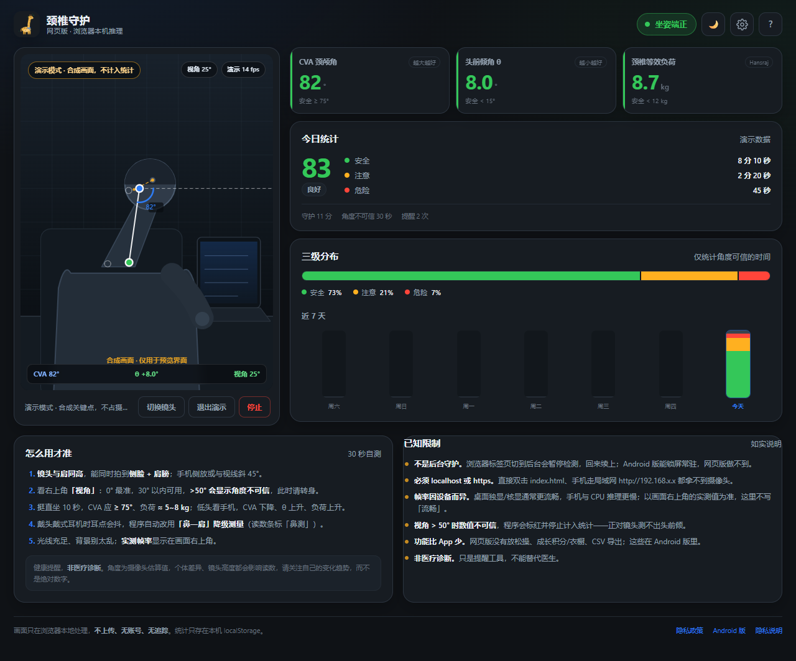
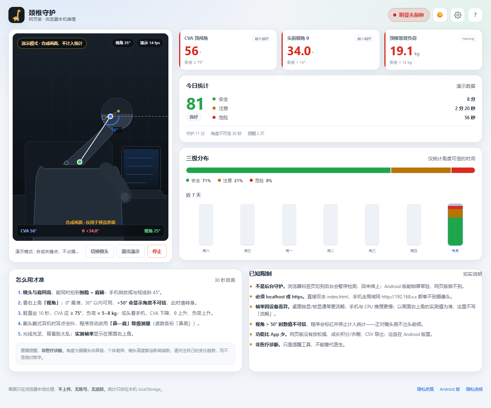

# 颈椎守护 · 网页版

> 用浏览器摄像头实时估算坐姿，低头太久会提醒你。
> **画面只在你自己的浏览器里处理，不上传、不录制、没有账号。**

这是 Android App「颈椎守护」的浏览器版。算法不是重写的：`js/posture.js` 是从 Kotlin 版
（`PostureAnalyzer.kt` / `PostureScore.kt` / `PostureStateMachine.kt` / `PoseMonitor.kt`）逐条翻译过来的同一份代码，
自带 **71 项 Node 自测**。网页版只重写了「拿摄像头 + 跑 MediaPipe + 画界面」这部分。





---

## 30 秒跑起来

```powershell
cd publish\web
.\serve.ps1
```

浏览器会自动打开 **http://localhost:8000**（不自动打开就手动输这个地址）。
按 `Ctrl+C` 停止。

如果 PowerShell 拦脚本：

```powershell
powershell -ExecutionPolicy Bypass -File .\serve.ps1
```

不想用脚本也可以手动起（任意静态服务器都行）：

```powershell
# Python 3
python -m http.server 8000 --bind 127.0.0.1
# 或 Node（需自己写 server 的话，直接跑 serve.ps1 更省事）
```

> **不要双击 `index.html`。** 见下一节。

---

## 为什么必须 `localhost` 或 `https`（这是最容易踩的坑）

浏览器只在**安全上下文（secure context）**里允许网页调用摄像头：

| 打开方式 | 能拿到摄像头 | 原因 |
|---|---|---|
| 双击 `index.html`（`file://`） | ❌ | 不是安全上下文，`getUserMedia` 直接报错 |
| `http://localhost:8000` | ✅ | localhost 被浏览器视为安全上下文 |
| `http://127.0.0.1:8000` | ✅ | 同上 |
| `http://192.168.x.x:8000`（手机局域网） | ❌ | 普通 http 不是安全上下文 |
| `https://你的域名/...`（GitHub Pages） | ✅ | HTTPS 是安全上下文 |

`serve.ps1` 默认只监听 `127.0.0.1`，就是为了让你用 `localhost` 打开。
页面本身也会检测：`file://` 或非安全上下文时，会在摄像头区域直接给出提示，不会假装能用。

---

## 手机上怎么用

三条路，按推荐顺序：

### 1）部署到 GitHub Pages（https，最省事）

Pages 天然是 HTTPS，手机打开就能授权摄像头。见下面「部署到 GitHub Pages」。

### 2）USB 连接 + `adb reverse`（不用部署）

把手机上的 `localhost:8000` 转发到电脑（Android 手机、已装 platform-tools）：

```powershell
adb reverse tcp:8000 tcp:8000
```

然后手机浏览器打开 **http://localhost:8000**。
手机访问的是它自己的 localhost，浏览器认为是安全上下文，摄像头可用。
（USB 断开后转发失效，重新执行一次即可。）

### 3）Chrome 启动参数（只建议调试用）

桌面 Chrome 可以用参数把某个 http 源临时当作安全上下文：

```powershell
& "C:\Program Files\Google\Chrome\Application\chrome.exe" `
  --user-data-dir="$env:TEMP\cg-chrome" `
  --unsafely-treat-insecure-origin-as-secure=http://192.168.1.5:8000 `
  http://192.168.1.5:8000
```

注意：**这个参数 Android/iOS 上的浏览器用不了**，且会降低该源的安全性，别长期这么用。
手机想走局域网 http，还是用 `adb reverse` 或部署 https。

> 手机竖屏/触控布局做了响应式，但**本次交付只在桌面 1280×800 视口截图验证过**，
> 手机上的实际手感需要你自己试一遍（见文末自测清单）。

---

## 网页版做了什么

| 能力 | 说明 |
|---|---|
| **实时坐姿监测** | `getUserMedia` 取流 → MediaPipe PoseLandmarker（浏览器 WASM/GPU）逐帧推理 |
| **三项指标** | CVA 颈颅角、头前倾角 θ、颈椎等效负荷（Hansraj 2014 插值） |
| **三级判定** | 安全 `< 15°` / 注意 `15~30°` / 危险 `≥ 30°`（阈值可在设置里改） |
| **画面标注** | canvas 画出算法实际用的耳/肩/鼻、CVA 连线与夹角、视角来源；读数条在画面底部 |
| **角度可信度** | 估计拍摄视角，**> 50° 显示「角度不可信」且不计入统计**（对齐 Android） |
| **平滑与降级** | 10 秒时间窗中位数；戴耳机耳点抖动时自动改「鼻—肩」降级测量 |
| **提醒** | 连续低头 / 15 分钟内累计低头 / 工作越久越敏感；页面横幅 + 提示音 + 震动 |
| **统计** | localStorage 存每天的分级秒数，今日 + 近 7 天柱状图，坐姿分与评价 |
| **主题** | 深色 / 浅色 / 跟随系统，手动切换 |
| **演示模式** | 没有摄像头也能看到完整界面（合成关键点，**不计入统计**） |
| **隐私说明** | 首次进入弹窗，明确「本机处理、不上传」；独立 `privacy.html` |

和 Android 版**没有**的：放松操、成长积分/小鹿衣橱、CSV 导出、后台常驻守护。

---

## 目录结构

```
publish/web/
├── index.html                     主界面（单页）
├── privacy.html                   网页版隐私说明（独立可访问）
├── css/
│   └── app.css                    深/浅两套主题变量 + 全部样式
├── js/
│   ├── app.js                     摄像头 / 推理循环 / canvas 标注 / 统计 / 主题 / 提醒
│   └── posture.js                 复用的小程序版算法（CVA / 负荷 / 分级 / 状态机…）
├── assets/
│   ├── pose_landmarker_lite.task  MediaPipe 姿态模型（5.51 MB，与 Android assets 同一份）
│   └── icon-512.png               品牌图标
├── serve.ps1                      一键静态服务器（Python 优先，Node 兜底）
├── test/
│   └── posture.selftest.js        算法自测（71 项）
├── screenshots/                   本次验证截图（深色 / 浅色 / 隐私弹窗 / 设置 / 落地页 / 错误态 / 隐私页）
└── README.md
```

模型文件 SHA256（与 `cervical-guard/android/app/src/main/assets/pose_landmarker_lite.task` 一致）：

```
59929E1D1EE95287735DDD833B19CF4AC46D29BC7AFDDBBF6753C459690D574A
```

---

## 算法与自测

```powershell
cd publish\web
node test\posture.selftest.js
# 通过 71 项，失败 0 项
```

`js/posture.js` 与小程序版同一份，只改了导出方式（Node `module.exports` + 浏览器 `window.Posture` 双兼容）。
网页版训练/推理与 Android 版口径一致：

- 阈值默认 **15° / 30°**（设置里可改，注意必须小于危险）
- 10 秒**时间窗**中位数平滑（不是帧数窗）
- 视角估计：`φ = atan(0.8 / (鼻偏移 / 耳间距))`，`0°` 最准，`> 50°` 不可信
- 提醒状态机：连续低头 `holdSeconds`（默认 180 秒，工作越久越短，最短 60%）+
  15 分钟内累计低头 300 秒；提醒后冷却 600 秒
- 耳点抖动 → 「鼻—肩」降级（含 -13° 经验偏移）
- 视角过正的时间单独记「角度不可信」，不进三级分布，也不拉低分数

### 算法之外，网页版自己负责的

摄像头取流、检测循环节流（默认 15 fps 上限，设置可调 5~30）、
`requestAnimationFrame` 与页面可见性、统计累计与跨天、主题、提醒音/震动、设置持久化。

---

## 验证到什么程度（诚实版）

本次在 **Windows + 无头 Chromium（1280×800）** 上实际验证了：

| 项目 | 结果 |
|---|---|
| 页面加载、深色主题截图 | ✅ `screenshots/01-dark-safe.png` |
| 浅色主题 + 危险态截图 | ✅ `screenshots/02-light-danger.png` |
| 首次进入隐私弹窗 | ✅ `screenshots/03-privacy-modal.png` |
| 设置面板、运行信息 | ✅ `screenshots/04-settings.png` |
| 落地页「在线试用」入口 | ✅ `screenshots/05-landing-entry.png` |
| 摄像头被拒/无摄像头时的错误提示 | ✅ `screenshots/06-camera-blocked.png`（无头环境实测 `NotAllowedError`，提示文案正确） |
| `serve.ps1`（Python 主路径 / Node 兜底） | ✅ 两条都实测：Python 200、Node 200 且 MIME 正确 |
| Pages 布局 A（docs/ 与 web/ 同级） | ✅ 用本地静态服务器 + 目录联接模拟，落地页链接与 `/web/` 资源加载正常 |
| MediaPipe `tasks-vision@0.10.20` 从 jsDelivr 加载 | ✅ 模块 + WASM 均 200 |
| 本地模型 `assets/pose_landmarker_lite.task` | ✅ 加载成功（DELEGATE=GPU） |
| 真实推理管线 | ✅ 用空白 320×240 帧跑通 `detectForVideo`（无人体，返回 0 个关键点，符合预期） |
| 单帧推理耗时（本机无头环境） | 首次调用 **340 ~ 3440 ms**（含计算图初始化，受缓存/GPU 初始化影响）；之后连续 5 次 **19.4 / 19.8 / 19.6 / 20.8 / 21.1 ms** |
| 演示模式循环帧率 | ~14 fps（受页面设置的 15 fps 上限约束） |
| `file://` 打开时的拦截提示 | ✅ 实测：页面提示「请运行 serve.ps1…」而不是静默失败 |
| 算法自测 | ✅ **71 项通过，0 失败** |
| **真实摄像头检测** | ❌ **未验证**：无头浏览器没有可授权摄像头（`NotAllowedError`）。需你在 Chrome/Edge 里授权后自测 |
| 手机 / iOS / Safari 实测 | ❌ 未测。只验证了桌面 Chromium 的响应式代码路径 |
| 真实帧率 | ⚠️ 上面是无头环境的推理耗时，**不是**你设备接摄像头后的帧率；页面右上角会显示实测值，不写「流畅」 |

> 上面那次 3.44 秒是 MediaPipe 第一次建图的开销，不代表稳态性能；第二次起才是每帧成本。
> 而且这是无头浏览器的软件 GPU，普通带独显/核显的笔记本通常更快，老手机 CPU 可能更慢。
> **所以请以你设备上画面右上角的「推理 xx fps」为准。**

---

## 自测清单（5 分钟，需要你自己做）

1. `.\serve.ps1` → 打开 `http://localhost:8000`，允许摄像头。
2. 把手机/电脑摄像头**侧对**自己：画面里要能同时看到**侧脸 + 肩膀**（正对镜头测不出头前倾）。
3. 看右上角「视角」：**0~30° 最佳**；如果变红显示「角度不可信」，说明你转得太正，侧一点。
4. **挺直坐 10 秒**，应看到：
   - 状态胶囊「坐姿端正」（绿）
   - CVA **≥ 75°**、θ **< 15°**、等效负荷 **≈ 5~8 kg**
5. **低头看手机 10 秒**，应看到：
   - CVA 下降、θ 上升、负荷上升
   - θ ≥ 15° 转「注意」（黄），θ ≥ 30° 转「明显头前伸」（红）
6. 戴头戴式耳机再试：读数条/右上角出现「鼻测」，说明走了鼻—肩降级，这是正常的。
7. 打开「今日统计」看分数与三级分布；连续用几天再看「近 7 天」柱状图。
8. 点右上角主题按钮切换浅色/深色；设置里改阈值看读数颜色是否跟着变。
9. 点「先看演示」可不开摄像头检查界面（演示数据明确标注，不计入统计）。

**它不会替你做医疗判断。** 读数只是摄像头估算，用来观察自己的趋势，不是诊断。

---

## 模型加载、CDN 与完全离线

默认加载顺序（`js/app.js` 顶部常量）：

1. **推理库（JS）**：`assets/vendor/vision_bundle.js`（若存在）→ jsDelivr → unpkg → fastly，每个 20 秒超时。
2. **WASM**：`assets/wasm/`（若存在，通过 HEAD 探测）→ jsDelivr → unpkg → fastly。
3. **模型**：`assets/pose_landmarker_lite.task`（本地，5.51MB）→ 本地不存在时才回落 Google `storage.googleapis.com`。

也就是说：**仓库里已经带了模型，正常联网只需要从 CDN 拉 JS/WASM**。

### 完全离线（内网 / 断网演示）

在 `publish\web` 下执行：

```powershell
New-Item -ItemType Directory -Force assets\vendor, assets\wasm | Out-Null

# 推理库（约 130 KB）
Invoke-WebRequest "https://cdn.jsdelivr.net/npm/@mediapipe/tasks-vision@0.10.20/vision_bundle.mjs" `
  -OutFile assets\vendor\vision_bundle.js

# WASM 四个文件（SIMD + 非 SIMD，各一个 .js + .wasm）
$base = "https://cdn.jsdelivr.net/npm/@mediapipe/tasks-vision@0.10.20/wasm"
foreach ($f in "vision_wasm_internal.js","vision_wasm_internal.wasm",
               "vision_wasm_nosimd_internal.js","vision_wasm_nosimd_internal.wasm") {
  Invoke-WebRequest "$base/$f" -OutFile "assets\wasm\$f"
}
```

之后页面会优先用本地文件，不再请求 CDN。注意：

- 这些是 **Apache-2.0** 许可的 MediaPipe 运行库，重分发时保留许可说明（项目根 `publish/github/NOTICE.md` 已列）。
- `assets/vendor/vision_bundle.js` 是 ESM 文件，只是扩展名改成了 `.js`（本地服务器 MIME 更稳）。
- 若 CDN 被墙且没做离线包，页面会明确报「姿态模型加载失败」，不会假装在检测。

---

## 部署到 GitHub Pages

有两种布局，**按你的 Pages 设置二选一**。落地页里的「网页版在线试用」链接会自动兼容：

### 布局 A（推荐）：Pages 源 = 仓库根

仓库结构：

```
<repo>/
├── docs/          ← 落地页（GitHub 上访问 /docs/）
└── web/           ← 网页版（访问 /web/）
```

```powershell
# 假设已按 publish/github 准备好仓库根
Copy-Item -Recurse publish\web <仓库根>\web
```

Settings → Pages → Source: **Deploy from a branch** → `main` / **`/ (root)`**。
访问：

- 落地页 `https://<用户名>.github.io/<仓库>/docs/`
- 网页版 `https://<用户名>.github.io/<仓库>/web/`

### 布局 B：Pages 源 = `/docs`（现有教程默认）

```powershell
Copy-Item -Recurse publish\web publish\github\docs\web
```

Settings → Pages → Source: `main` / **`/docs`**。
落地页 `https://<用户名>.github.io/<仓库>/`，网页版 `https://<用户名>.github.io/<仓库>/web/`。
`docs/index.html` 里的脚本会探测 `../web/` 不可用时自动改链到 `web/`。

> 布局 B 会把 5.5MB 模型复制一份到 `docs/web/assets/`，仓库多 5.5MB；能接受就直接用，介意就走布局 A。

部署后手机直接打开 `https://.../web/`，摄像头可用。

---

## 数据与隐私

- 不录像、不截图、不上传画面；关键点算完即丢。
- 只把「安全 / 注意 / 危险 / 角度不可信」的**秒数**和提醒次数写进 `localStorage`：
  - `cervicalguard.web.stats.v1`
  - `cervicalguard.web.settings.v1`
  - `cervicalguard.web.theme.v1`
  - `cervicalguard.web.privacyAck.v1`
- 设置弹窗里有「清除今日统计」「清空全部本地数据」。
- 联网请求只有：从 CDN 下载 MediaPipe 的 JS/WASM（不含画面）；模型默认本地。
- 完整说明见 [privacy.html](privacy.html)。

---

## 常见问题

**1. 双击 index.html，点开启摄像头没反应 / 报错？**
浏览器禁止 `file://` 访问摄像头。用 `serve.ps1` 起服务，开 `http://localhost:8000`。页面顶部也会提示。

**2. `NotAllowedError`：摄像头权限被拒绝**
点地址栏左侧的相机/锁图标 → 允许摄像头 → 刷新页面。如果是公司电脑受策略管控，可能无法授权。

**3. 手机用 `http://192.168.x.x` 打不开摄像头**
正常，非安全上下文。用 `adb reverse tcp:8000 tcp:8000` + 手机开 `http://localhost:8000`，或部署到 Pages（https）。

**4. `NotFoundError` / 黑屏**
没有摄像头，或被会议软件/其它标签页占用。关掉占用程序后刷新。外接摄像头要在系统里启用。

**5. 一直显示「未检出」**
- 人没有完整入镜：需要**侧脸 + 肩膀**，镜头别太高/太低。
- 光线太暗或逆光；背景太乱。
- 摄像头画面被镜像/旋转：网页版已按前置摄像头做镜像标注，若你外接摄像头方向不对，可以在 `openCamera()` 的 `facingMode` 处调整（默认 `user`）。

**6. 显示「角度不可信」**
你太正对镜头了（视角 > 50°）。侧身让镜头看到侧脸；这是算法诚实，不是 bug。

**7. CDN 不通 / 模型加载失败**
页面会提示。先确认能访问 `cdn.jsdelivr.net`；完全离线按上面「完全离线」放文件。局域网可自建静态服务器托管 `assets/wasm` 和 `assets/vendor`。

**8. 帧率低**
设置里把「推理帧率上限」降到 8~10；关掉其它吃 GPU 的程序；用 Chrome/Edge（Safari 的 WASM/GPU 路径可能更慢）。
页面右上角显示的是**你这台设备当前实测值**，没有统一答案。

**9. 切到别的标签页回来，计时/提醒怪怪的？**
浏览器会暂停后台页面，检测也会暂停。回到前台后若离开超过 30 秒，程序会重置平滑窗与提醒状态机，避免「一回来就误报」。所以网页版不能当后台守护用。

**10. 端口 8000 被占用**
`.\serve.ps1 -Port 8080`。

**11. PowerShell 不让运行脚本**
`powershell -ExecutionPolicy Bypass -File .\serve.ps1`（或用 `python -m http.server 8000`）。

---

## 已知限制（不粉饰）

1. **必须安全上下文**：`file://` 和局域网 http 都拿不到摄像头。
2. **不能后台守护**：标签页隐藏即暂停，没有 Android 前台服务那种常驻能力。
3. **真机摄像头未验证**：本次只有无头浏览器环境，无法验证真实检测效果；请按自测清单亲自试。
4. **帧率不保证**：取决于设备、浏览器、分辨率和是否走 GPU；页面显示实测值。
5. **只有桌面 Chromium 截图验证**，手机竖屏/触控/Safari/iOS 需自测。
6. **功能是 App 的子集**：没有放松操、成长系统、CSV 导出。
7. **不做医疗诊断**：角度是估算值，不能替代医生。

---

## 许可

- 本项目代码：MIT（见仓库根 `LICENSE`）。
- MediaPipe（`@mediapipe/tasks-vision`、`pose_landmarker_lite.task`）：Apache-2.0，
  详见 `publish/github/NOTICE.md`。
- 品牌图标与吉祥物：项目自有素材。
